# EduSaaS CRM — Entity-Relationship Diagram (ERD)

This document visualizes the complete database architecture and relations implemented in **Prompt 1 (Database and Multi-Tenant Foundation)** using Mermaid ER syntax.

---

## High-Level Architecture & Entity Groups

The architecture is divided into five core domains:

1. **Multi-Tenancy & Institution Hierarchy:** `tenants`, `tenant_domains`, `tenant_settings`
2. **User Identity & Security:** `users`, `refresh_tokens`, `login_history`
3. **Role-Based Access Control (RBAC):** `roles`, `permissions`, `role_permissions`, `memberships`
4. **Academic Operations Core:** `academic_sessions`
5. **SaaS Subscription & Monetization:** `subscription_plans`, `plan_features`, `subscriptions`, `subscription_invoices`, `subscription_payments`, `audit_logs`

---

## Mermaid ER Diagram

```mermaid
erDiagram
    TENANTS ||--o{ TENANT_DOMAINS : owns
    TENANTS ||--o{ TENANT_SETTINGS : configures
    TENANTS ||--o{ MEMBERSHIPS : binds
    TENANTS ||--o{ ROLES : defines_custom
    TENANTS ||--o{ ACADEMIC_SESSIONS : operates
    TENANTS ||--o{ SUBSCRIPTIONS : subscribes
    TENANTS ||--o{ SUBSCRIPTION_INVOICES : billed
    TENANTS ||--o{ SUBSCRIPTION_PAYMENTS : pays
    TENANTS ||--o{ AUDIT_LOGS : records

    USERS ||--o{ MEMBERSHIPS : holds
    USERS ||--o{ REFRESH_TOKENS : owns
    USERS ||--o{ LOGIN_HISTORY : logs
    USERS ||--o{ AUDIT_LOGS : performs

    ROLES ||--o{ ROLE_PERMISSIONS : includes
    ROLES ||--o{ MEMBERSHIPS : assigned_to

    PERMISSIONS ||--o{ ROLE_PERMISSIONS : mapped_in

    SUBSCRIPTION_PLANS ||--o{ PLAN_FEATURES : provides
    SUBSCRIPTION_PLANS ||--o{ SUBSCRIPTIONS : dictates

    SUBSCRIPTIONS ||--o{ SUBSCRIPTION_INVOICES : generates
    SUBSCRIPTION_INVOICES ||--o{ SUBSCRIPTION_PAYMENTS : receipts

    TENANTS {
        uuid id PK
        string name
        string slug UK
        enum institution_type "SCHOOL | COLLEGE"
        enum status "TRIAL | ACTIVE | SUSPENDED | INACTIVE"
        string email
        string phone
        string timezone
        string currency
        boolean is_deleted
        timestamptz created_at
        timestamptz updated_at
    }

    TENANT_DOMAINS {
        uuid id PK
        uuid tenant_id FK
        string domain UK
        boolean is_primary
        boolean is_verified
        timestamptz created_at
        timestamptz updated_at
    }

    TENANT_SETTINGS {
        uuid id PK
        uuid tenant_id FK
        string key
        jsonb value
        boolean is_public
        boolean is_deleted
        timestamptz created_at
        timestamptz updated_at
    }

    USERS {
        uuid id PK
        string email UK
        string password_hash
        string full_name
        string phone
        string avatar_url
        boolean is_active
        boolean is_superadmin
        boolean mfa_enabled
        timestamptz last_login_at
        boolean is_deleted
        timestamptz created_at
        timestamptz updated_at
    }

    REFRESH_TOKENS {
        uuid id PK
        uuid user_id FK
        string token_hash UK
        timestamptz expires_at
        boolean is_revoked
        timestamptz revoked_at
        string ip_address
        string user_agent
        timestamptz created_at
    }

    LOGIN_HISTORY {
        uuid id PK
        uuid user_id FK
        uuid tenant_id FK
        string email
        enum status "SUCCESS | FAILED"
        string failure_reason
        string ip_address
        string user_agent
        timestamptz created_at
    }

    ROLES {
        uuid id PK
        uuid tenant_id FK "nullable for platform roles"
        string name
        string code
        enum scope "PLATFORM | TENANT"
        string description
        boolean is_system_role
        timestamptz created_at
        timestamptz updated_at
    }

    PERMISSIONS {
        uuid id PK
        string code UK
        string module
        string description
        timestamptz created_at
    }

    ROLE_PERMISSIONS {
        uuid id PK
        uuid role_id FK
        uuid permission_id FK
        timestamptz created_at
    }

    MEMBERSHIPS {
        uuid id PK
        uuid tenant_id FK
        uuid user_id FK
        uuid role_id FK
        enum status "ACTIVE | INVITED | SUSPENDED"
        boolean is_deleted
        timestamptz created_at
        timestamptz updated_at
    }

    ACADEMIC_SESSIONS {
        uuid id PK
        uuid tenant_id FK
        string name
        string code
        date start_date
        date end_date
        boolean is_current
        enum status "UPCOMING | ACTIVE | COMPLETED | ARCHIVED"
        boolean is_deleted
        timestamptz created_at
        timestamptz updated_at
    }

    SUBSCRIPTION_PLANS {
        uuid id PK
        string name
        string code UK
        enum institution_type "SCHOOL | COLLEGE"
        enum billing_cycle "MONTHLY | QUARTERLY | YEARLY"
        numeric price
        string currency
        boolean is_active
        timestamptz created_at
        timestamptz updated_at
    }

    PLAN_FEATURES {
        uuid id PK
        uuid plan_id FK
        string feature_key
        jsonb feature_value
        boolean is_enabled
        timestamptz created_at
    }

    SUBSCRIPTIONS {
        uuid id PK
        uuid tenant_id FK
        uuid plan_id FK
        enum status "TRIAL | ACTIVE | PAST_DUE | CANCELED | EXPIRED"
        enum billing_cycle "MONTHLY | QUARTERLY | YEARLY"
        timestamptz current_period_start
        timestamptz current_period_end
        timestamptz trial_ends_at
        timestamptz canceled_at
        boolean is_auto_renew
        timestamptz created_at
    }

    SUBSCRIPTION_INVOICES {
        uuid id PK
        uuid tenant_id FK
        uuid subscription_id FK
        string invoice_number UK
        numeric subtotal
        numeric tax_amount
        numeric total_amount
        string currency
        enum status "DRAFT | ISSUED | PAID | VOID | UNCOLLECTIBLE"
        date due_date
        timestamptz paid_at
        timestamptz created_at
    }

    SUBSCRIPTION_PAYMENTS {
        uuid id PK
        uuid tenant_id FK
        uuid invoice_id FK
        numeric amount
        string currency
        string payment_method
        string gateway
        string transaction_reference UK
        enum status "PENDING | SUCCESS | FAILED | REFUNDED"
        timestamptz paid_at
        jsonb payload
        timestamptz created_at
    }

    AUDIT_LOGS {
        uuid id PK
        uuid tenant_id FK
        uuid user_id FK
        string action
        string entity_type
        string entity_id
        string ip_address
        string user_agent
        jsonb changes
        timestamptz created_at
    }
```

